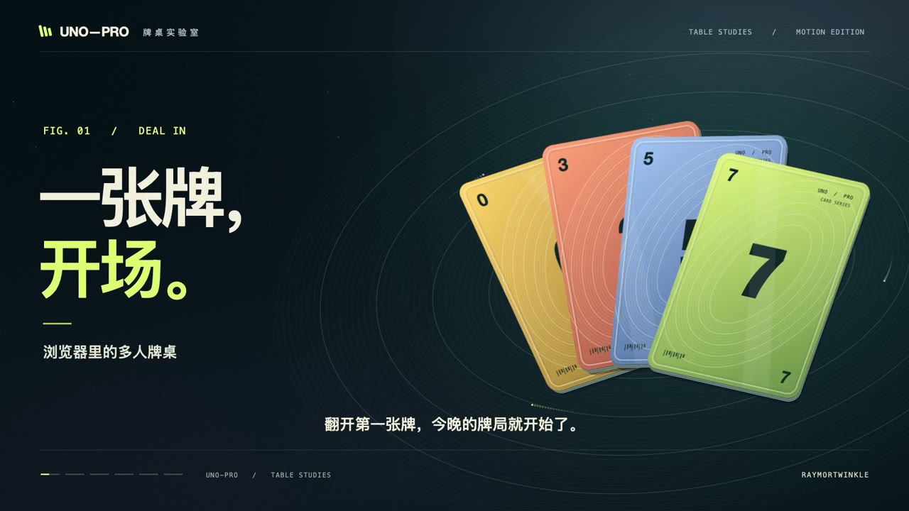

# UNO-PRO · 今晚，开一桌。

一台电脑当桌主，朋友用手机或电脑浏览器入座。五款游戏共用大厅、房间和计分界面。一个人想先试牌，可以给 UNO 房间添加不同难度的机器人。

[](docs/media/promo.mp4)

[中文试牌台源文件，可直接本地打开](docs/index.html) · [观看中文短片](docs/media/promo.mp4) · [查看可复现实验](docs/evals/refactor-1126-report.md)

## 开第一桌

准备 Node.js 22.13 或更新版本，下载源码并进入含根目录 `package-lock.json` 的目录。在这里运行：

```bash
npm ci
npm start
```

1. 在桌主电脑打开终端显示的本机地址，默认是 `http://localhost:3501`。输入昵称，选择游戏，创建房间。
2. **一个人玩**可以直接选机器人难度并添加座位。**和朋友玩**请让手机连到同一个局域网，打开终端显示的局域网地址，在大厅用房间码加入。手机使用桌主电脑的地址。
3. 在 UNO 房间展开「村规 / 高级规则」，约好打完一名就收桌，还是一路打到最后。点击「开始游戏」。

首次安装需要网络。局域网桌主需要允许 Node 接受本地网络连接。关闭桌主进程会结束内存里的房间。GitHub Pages 托管的试牌台可以单独打开，真人组局需要保持上面的游戏服务运行。

## 今晚玩什么

| 游戏 | 座位 | 一局的关键动作 |
| --- | --- | --- |
| UNO | 2–8 | 配色或配点出牌。逐名次赛中，已经出完的玩家留在名次表，其余玩家继续。 |
| 牛头王 | 2–8 | 同时暗选，翻开后逐张接入四行，想清楚谁会吃下整行牛头。 |
| 吹牛 | 2–6 | 扣牌、报数，决定要不要揭穿上一家的声明。 |
| 你画我猜 | 3–8 | 一个人作画，其余人猜词，下一轮交换角色。 |
| 铃儿响叮当 | 2–6 | 翻开水果，盯住数量，抢铃也要承担拍错的代价。 |

### UNO 房间里的十二项设置

| 想改什么 | 房主能调哪些选项 |
| --- | --- |
| 摸牌叠加 | ① +2 叠加　② +4 叠加　③ +2/+4 互叠 |
| 手牌归属 | ④ 打 0 轮转　⑤ 打 7 指定换手 |
| 出牌机会 | ⑥ 同牌抢出　⑦ 同数字全出　⑧ 摸到能出为止 |
| 质疑与罚摸 | ⑨ 关闭 +4 质疑　⑩ UNO 罚摸张数（2 / 4 / 6） |
| 收桌方式 | ⑪ 末位淘汰　⑫ 三人及以上逐名次赛 |

机器人提供萌新、简单、普通、困难四档。策略先使用规则引擎给出的合法动作，再结合手牌、有效下家和难度选牌。在测试里可以固定随机源，重放同一个决策。

## 为什么测「谁还能接牌」

设想甲刚出完，乙打出 0，丙还握着一手牌。若程序沿着最初的座位表轮转，甲可能带着第一名又拿到手牌。这里的修复把回合推进、手牌流转与机器人选目标统一到本轮仍在场的座位。结束顺序依然留给计分和界面展示。

同一批 64 个种子各跑三种房规。先出完即结束，两版均正常结算 64 局。默认逐名次由 59 局增至 64 局；再开启 0 轮转和 7 换手，由 6 局增至 64 局。每局都必须在步数上限内结束，并始终满足名次与行动权约束。

另一个检查直接从玩家视角进入。摸牌者需要看到刚摸到的牌以决定是否打出，对手和旁观者只需要知道「有人摸牌」。测试分别检查三份视图，并回头核对摸牌者的原始记录。[实验方法与逐项输出](docs/evals/refactor-1126-report.md)

## 代码入口

| 想看什么 | 从这里读 |
| --- | --- |
| 卡牌、轮次与计分 | [UNO 引擎](packages/shared/src/engine.ts) |
| 四档 AI 如何选动作 | [规则机器人](packages/shared/src/bot.ts) |
| 真人、机器人和计时器如何驱动同一桌 | [游戏运行时接口](packages/shared/src/games/types.ts) |
| 一局牌如何拆成每个人的视图 | [UNO 运行时](packages/shared/src/games/uno/runtime.ts) |
| 五款游戏如何共用房间 | [游戏目录与工厂](packages/shared/src/games/registry.ts) |

```bash
npm test
npm run typecheck
npm run build
```

若遇到规则争议，记录人数、开启的村规、当前方向、谁已出完、操作和预期下家。固定种子或最小手牌局面能帮助维护者重放问题。请用虚构昵称与手牌样例。

## 战绩、语音与音乐

开源版采用本机访客档案，桌主使用 SQLite 保存战绩。播报使用浏览器提供的语音，实际可选声线取决于设备。背景音乐与提示音由 Web Audio 生成。跨设备注册账号、生产数据库以及既有录音留在私有版。

## 许可

本仓代码采用 MIT 许可。依赖保留各自许可。片中的人声与宣传视频仅供随项目展示，未纳入代码许可。UNO 等游戏名称用于标识玩法，相关名称和商标归各自权利人所有。[代码许可](LICENSE)
