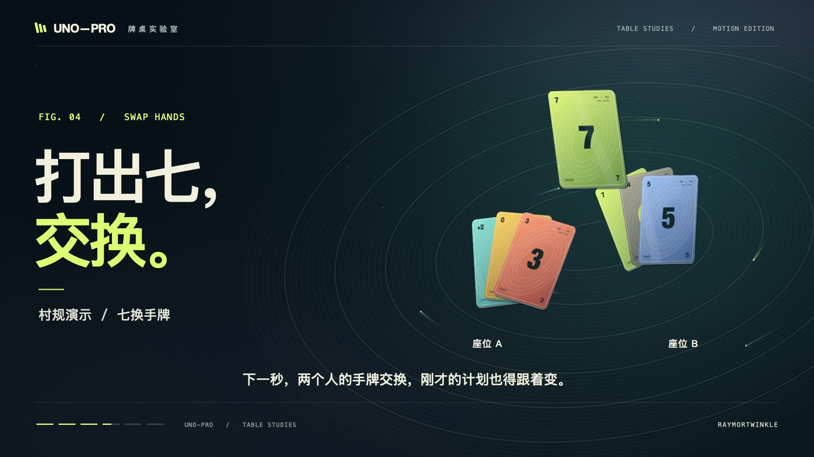
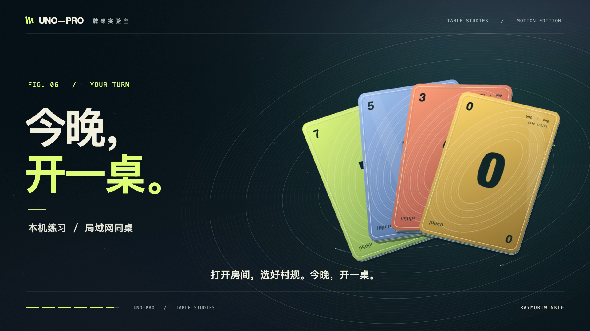
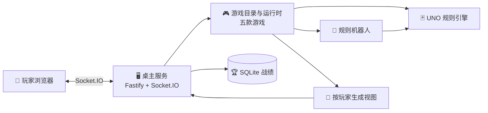

<div align="center">

# 🃏 UNO-PRO

**今晚，开一桌。**  把朋友叫上，把牌发出去，剩下的交给笑声。

[](packages/client/package.json)
[](package.json)
[](packages/server/package.json)
[](LICENSE)
[](https://raymortwinkle.github.io/uno-pro-open/)
[](https://raymortwinkle.github.io/uno-pro-open/media/promo.mp4)
[](https://github.com/RayMorTwinkle/uno-pro-open)

[✨ 在线交互体验站](https://raymortwinkle.github.io/uno-pro-open/) · [🎬 观看中文宣传片](https://raymortwinkle.github.io/uno-pro-open/media/promo.mp4) · [🚀 3 分钟上手](#3-分钟本地跑起来) · [📊 实测对比](#实测改善) · [🏗️ 核心架构](#工作原理)

</div>

<div align="center">

[](https://raymortwinkle.github.io/uno-pro-open/media/promo.mp4)

**▶ 点击封面，观看中文宣传片** · [打开在线试牌台](https://raymortwinkle.github.io/uno-pro-open/)

<video controls width="800" poster="docs/media/promo-poster.jpg" src="https://raymortwinkle.github.io/uno-pro-open/media/promo.mp4">
  你的阅读器不支持内嵌视频，请使用上方链接观看。
</video>

GitHub README 可能不显示内嵌播放器；点击封面或[直接播放视频](https://raymortwinkle.github.io/uno-pro-open/media/promo.mp4)即可。

</div>

<table>
  <tr>
    <td align="center"><br><strong>🔄 一张 7，换个局面</strong><br>村规一开，计划也要跟着变。</td>
    <td align="center"><br><strong>🎉 今晚，轮到你了</strong><br>本机练习，或和朋友局域网同桌。</td>
  </tr>
</table>

> 以上为宣传片视觉画面。在线试牌台可独立体验；真人组局需要运行本地游戏服务。

## 💡 为什么做它？

朋友都到了，却还在找牌、凑桌、争论「这张到底能不能出」？UNO-PRO 把牌桌搬进浏览器：一台电脑当桌主，朋友拿手机或电脑入座，规则交给游戏处理。一个人想先热身，也能在 UNO 房间叫上机器人。

## ✨ 核心亮点

- 🎲 **一桌五种玩法**：UNO、牛头王、吹牛、你画我猜、铃儿响叮当共用大厅、房间和计分界面。
- 📱 **朋友一起上桌**：桌主启动服务，局域网内的朋友用浏览器和房间码加入；也可以观战。
- 🤖 **四档规则机器人**：UNO 支持萌新、简单、普通、困难；机器人从合法动作中选牌，使用规则策略而非模型推理。
- 🃏 **十二项 UNO 房规**：从 +2/+4 叠加、0 轮转、7 换手，到抢出、质疑和逐名次赛，让房主把这桌的玩法说清楚。
- 🏆 **留住每一局的战绩**：本机访客档案搭配桌主的 SQLite 战绩；浏览器语音与 Web Audio 为牌桌添点声音。

<details>
<summary><strong>🎮 五款游戏怎么入座？</strong></summary>

| 游戏 | 座位 | 这一局玩什么 |
| --- | --- | --- |
| UNO | 2–8 | 配色或配点出牌，也可以一路打到逐名次结算。 |
| 牛头王 | 2–8 | 同时暗选、依次接牌，小心吃下一整行牛头。 |
| 吹牛 | 2–6 | 扣牌报数，判断要不要揭穿上一家。 |
| 你画我猜 | 3–8 | 一人作画，其他人猜词，轮流交换角色。 |
| 铃儿响叮当 | 2–6 | 翻水果、数数量，抢铃也要承担拍错的代价。 |

</details>

## 🏗️工作原理

从入座到出牌，客户端负责交互，桌主服务负责房间通信，共享游戏运行时与规则引擎处理牌局和玩家视图。



想读代码？从 [游戏目录与工厂](packages/shared/src/games/registry.ts)、[运行时接口](packages/shared/src/games/types.ts)、[UNO 引擎](packages/shared/src/engine.ts)、[机器人策略](packages/shared/src/bot.ts)和 [UNO 视图](packages/shared/src/games/uno/runtime.ts)开始。

## 📊实测改善

**已经出完牌的人，怎么又拿到了牌？** 逐名次赛里，回合推进和换手曾把已排名的玩家重新拉回牌局。这次重构统一了仍在场席位的判断，也检查了摸牌信息对不同身份的可见性。

| 检查项 | 重构前 | 重构后 | 统计单位 |
| --- | ---: | ---: | --- |
| 首人出完即结束（对照组） | 64/64 | **64/64** | 合规结算的牌局 |
| 默认逐名次赛 | 59/64 | **64/64** | 合规结算的牌局 |
| 逐名次赛 + 0 轮转 + 7 换手 | 6/64 | **64/64** | 合规结算的牌局 |
| 定向规则回归 | 2/16 | **16/16** | 通过的固定牌例 |
| 摸牌可见性 | 1/3 | **3/3** | 通过的身份视角 |

<details>
<summary><strong>🔎 这些数字是怎么测出来的？</strong></summary>

2026-11-26 的对照评测中，三组各使用相同的 64 个种子，模拟四人牌局；牌局须在 2,000 次动作内结束，并满足手牌、行动权和名次约束。固定牌例与视角检查在两版使用相同测试代码。这些结果只描述本批样本，不代表胜率或运行速度；网络并发、异步抢出、重连、浏览器延迟和真人对局需要另行测量。

开源包的局域网验收连接均在同一台主机，未使用第二台实体手机。评测方法、原始结果和复跑命令见 [完整评测报告](docs/evals/refactor-1126-report.md)。

</details>

## 🚀3 分钟本地跑起来

准备 **Node.js 22.13 或更新版本**。下载或克隆本仓库，进入包含根目录 `package-lock.json` 的目录，然后运行：

```bash
npm ci
npm start
```

1. 在桌主电脑打开终端显示的本机地址（默认 `http://localhost:3501`），输入昵称、选择游戏并创建房间。
2. **自己练习**：在 UNO 房间添加机器人，选好难度即可开局。
3. **朋友同桌**：让手机或电脑连到同一局域网，打开终端显示的局域网地址，在大厅用房间码加入。房主可以先约好村规，再点击开始游戏。

首次安装需要网络，桌主可能需要允许 Node 接受局域网连接；安装时间取决于网络环境。关闭桌主进程会结束内存中的房间。GitHub Pages 上的试牌台可单独打开，真人组局需要保持游戏服务运行。

想检查项目？在仓库根目录运行：

```bash
npm test
npm run typecheck
npm run build
```

## 📚 延伸阅读 & 许可

- ✨ [在线交互体验站](https://raymortwinkle.github.io/uno-pro-open/) · [本地试牌台源文件](docs/index.html)
- 🎬 [中文宣传片](https://raymortwinkle.github.io/uno-pro-open/media/promo.mp4) · [评测报告与复跑方法](docs/evals/refactor-1126-report.md)
- 👋 [Ray 的个人主页](https://raymor.top) · [代码许可 MIT](LICENSE) · [素材与商标说明](NOTICE.md)

代码与配套技术文档采用 MIT 许可，依赖保留各自许可。展示影片及其中的人声、音乐和画面未随源码授予再分发、抽取或克隆声线的许可；游戏名称和商标归各自权利人所有。

<div align="center">

**觉得这张牌桌有意思？点个 ⭐ Star，下次叫朋友一起玩。**

</div>
